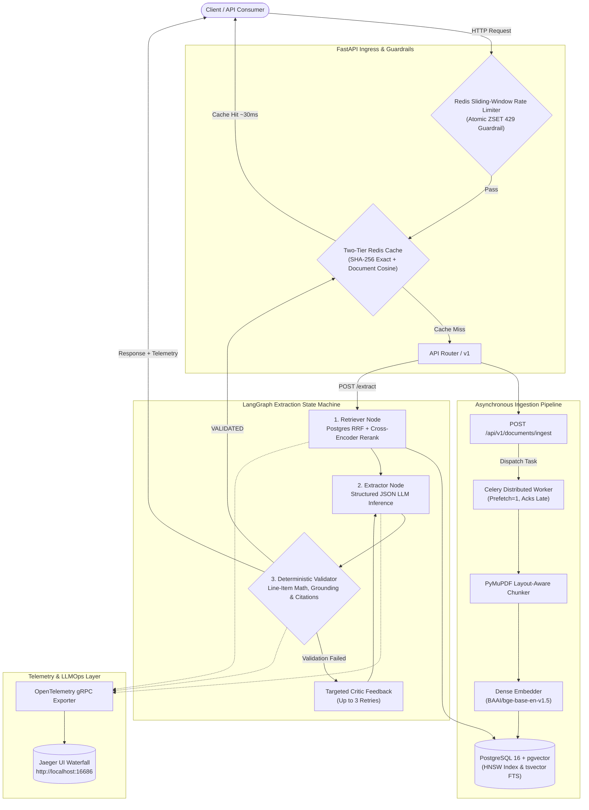

# DocuFlow AI: Event-Driven Unstructured Document Extraction & Hybrid RAG Engine

[](https://www.python.org/)
[](https://fastapi.tiangolo.com/)
[-336791.svg)](https://github.com/pgvector/pgvector)
[](https://redis.io/)
[](https://docs.celeryq.dev/)
[](https://langchain-ai.github.io/langgraph/)
[](https://opentelemetry.io/)

**DocuFlow AI** is a production-grade, event-driven document processing and structured financial extraction platform. It bridges asynchronous ingestion pipelines with a hybrid retrieval-augmented generation (RAG) engine, a self-correcting multi-agent extraction state machine (LangGraph), and an enterprise LLMOps observability layer with two-tier semantic caching and distributed tracing.

---

## 🏗️ System Architecture



---

## ⚡ Core Engineering Features

### 1. Asynchronous Ingestion & Layout-Aware Chunking (Task 1)
- **Non-blocking ingestion:** Fast acceptance (`HTTP 202 Accepted`) returning an ingestion `job_id` while heavy PDF parsing is offloaded to background Celery workers via Redis.
- **Structural fidelity:** Uses PyMuPDF to extract text with layout metadata (page numbers, structural headers, line blocks).
- **Dense Vectorization:** Chunks embedded via fast CPU-optimized ONNX model (`BAAI/bge-base-en-v1.5`, 768-dim) and written to PostgreSQL with HNSW indexes.

### 2. Hybrid RAG: pgvector HNSW + BM25 tsvector + Cross-Encoder (Task 2)
- **Stage 1: Reciprocal Rank Fusion (RRF) in SQL:** Executes parallel vector distance search (`embedding <=> query_vec` via HNSW) and keyword search (`search_vector @@ websearch_to_tsquery('english', query)`), combining ranks using:
  $$RRF(d) = \frac{1}{60 + r_{dense}} + \frac{1}{60 + r_{sparse}}$$
- **Stage 2: Cross-Encoder Reranking:** Top 20 candidates are re-scored using `cross-encoder/ms-marco-MiniLM-L-6-v2` down to Top 5 high-precision context chunks with explicit citation tags.

### 3. Stateful Self-Correcting Multi-Agent Extraction (Task 3)
- Built on **LangGraph** with a cyclic state machine:
  - **`node.retriever`**: Gathers top chunks with citation metadata.
  - **`node.extractor`**: Extracts structured JSON conforming to `DocumentExtractionResult` schema.
  - **`node.validator`**: Executes deterministic, zero-tolerance domain checks:
    - Verifies line item multiplication: $\text{qty} \times \text{unit\_price} == \text{total\_price} \pm 0.05$.
    - Verifies mathematical summation: $\sum \text{items} == \text{subtotal} \pm 0.05$.
    - Anti-hallucination citation checks: guarantees cited chunk indices exist in retrieved context.
    - Vendor and entity grounding verification.
  - **Critic Loop**: If validation fails, critic error notes are fed directly into Attempt #2's user prompt for targeted self-correction (max 3 retries).

### 4. Enterprise LLMOps, Semantic Caching & Telemetry (Task 4)
- **Redis Sliding-Window Rate Limiter:** Protects expensive endpoints against runaway loops using an atomic Redis Sorted Set (`ZSET`) pipeline (`ZREMRANGEBYSCORE`, `ZCARD`, `ZADD`, `EXPIRE`). Exceeding thresholds returns RFC-compliant `HTTP 429 Too Many Requests` with a precise `Retry-After` header.
- **Two-Tier Document-Scoped Semantic Cache:**
  - **Tier 1 (Exact Hash):** Normalized SHA-256 hash lookup in Redis (`< 2ms`).
  - **Tier 2 (Semantic Cosine Matching):** Cosine vector similarity ($\ge 0.90$) scoped to the document (`cache:{job_id}:semantic_queries`). Paraphrased queries drop execution time from **~6,300ms to ~35ms** with 0 tokens consumed.
- **OpenTelemetry Distributed Tracing:** Instrumenting FastAPI root requests down into nested child spans (`node.retriever`, `node.extractor`, `node.validator`). Traces are exported over gRPC to Jaeger, correlating responses via `X-Trace-Id`.
- **Diagnostic Telemetry Contract:** Returns comprehensive runtime metadata:
  ```json
  "telemetry": {
    "trace_id": "05eb166eaf3b1336e32038a01e001766",
    "cache_status": "HIT_SEMANTIC",
    "cache_similarity": 0.939,
    "retry_count": 0,
    "validation_history": [],
    "tokens": { "prompt_tokens": 0, "completion_tokens": 0, "total_tokens": 0, "estimated_cost_usd": 0.0 },
    "latency_breakdown_ms": {
      "total_ms": 35.01,
      "cache_lookup_ms": 23.33,
      "retrieval_and_rerank_ms": 0.0,
      "llm_extraction_ms": 0.0,
      "validation_ms": 0.0
    }
  }
  ```

---

## 🚀 Local Setup & Installation

### Prerequisites
- [Docker & Docker Compose](https://www.docker.com/)
- [Python 3.12+](https://www.python.org/)
- A [Groq API Key](https://console.groq.com/) (free tier available)

---

### Step 1: Clone the Repository & Configure Environment

```bash
git clone https://github.com/your-username/DocuFlow_AI.git
cd DocuFlow_AI
```

Create your local `.env` from the provided example:
```bash
# On Linux/macOS
cp .env.example .env

# On Windows (PowerShell)
Copy-Item .env.example .env
```

Open `.env` and fill in your credentials:
```env
PROJECT_NAME="DocuFlow AI"
ENVIRONMENT="development"

# PostgreSQL (Matches docker-compose.yml)
POSTGRES_SERVER=localhost
POSTGRES_PORT=5432
POSTGRES_USER=docuflow_user
POSTGRES_PASSWORD=m!MHsn660<
POSTGRES_DB=docuflow_db

# Redis (Matches docker-compose.yml)
REDIS_HOST=localhost
REDIS_PORT=6379

# Groq LLM API
GROQ_API_KEY=your_actual_groq_api_key_here
GROQ_MODEL=openai/gpt-oss-120b
```

---

### Step 2: Spin Up Infrastructure (Postgres, Redis, Jaeger)

Start all backing services in detached mode:
```bash
docker compose up -d
```

Verify all 3 containers are healthy:
```bash
docker compose ps
```
- **Postgres (pgvector)** $\to$ `localhost:5432`
- **Redis 7** $\to$ `localhost:6379`
- **Jaeger UI** $\to$ `http://localhost:16686` (OTLP gRPC receiver on `4317`)

---

### Step 3: Set Up Python Virtual Environment

```bash
# Create virtual environment
python -m venv backend/.venv

# Activate virtual environment
# Windows (PowerShell):
.\backend\.venv\Scripts\Activate.ps1
# Linux / macOS:
source backend/.venv/bin/activate

# Install dependencies
pip install -r backend/requirements.txt
```

---

### Step 4: Initialize the Database (pgvector & Schema)

Run the automated database migration script to enable the vector extension and create the required tables and HNSW indexes:
```bash
cd backend
python -m app.db.init_db
```
*Expected output:*
```text
Initializing database...
Enabling vector extension...
Creating database table and indexes...
Database initialized successfully!
```

---

### Step 5: Start the Celery Ingestion Worker

In a dedicated terminal (from the `backend/` directory with `.venv` active):

```bash
# On Windows (use -P solo):
celery -A app.worker.celery_app.celery_app worker --loglevel=info -P solo

# On Linux / macOS:
celery -A app.worker.celery_app.celery_app worker --loglevel=info
```

---

### Step 6: Start the FastAPI Application Server

In another terminal (from the `backend/` directory with `.venv` active):

```bash
uvicorn app.main:app --reload --port 8000
```

The application is now live at:
- **Interactive Swagger Docs:** [http://localhost:8000/docs](http://localhost:8000/docs)
- **Health Check:** [http://localhost:8000/health](http://localhost:8000/health)
- **Jaeger Tracing Dashboard:** [http://localhost:16686](http://localhost:16686)

---

## 🧪 End-to-End Walkthrough & Testing Guide

Here is a step-by-step example you can execute to test the entire lifecycle:

### 1. Ingest an Unstructured Document
Upload a PDF invoice or financial statement:
```bash
curl -X POST "http://127.0.0.1:8000/api/v1/documents/ingest" \
     -H "accept: application/json" \
     -H "Content-Type: multipart/form-data" \
     -F "file=@sample_invoice.pdf"
```
**Response (`HTTP 202 Accepted`):**
```json
{
  "job_id": "47dcd284-6420-4e37-869d-33e055b5da6f",
  "filename": "sample_invoice.pdf",
  "status": "PENDING"
}
```

### 2. Poll Ingestion Status
Check whether the Celery worker has parsed, embedded, and indexed all layout chunks:
```bash
curl -X GET "http://127.0.0.1:8000/api/v1/documents/jobs/47dcd284-6420-4e37-869d-33e055b5da6f"
```
**Response:**
```json
{
  "job_id": "47dcd284-6420-4e37-869d-33e055b5da6f",
  "filename": "sample_invoice.pdf",
  "status": "COMPLETED",
  "chunks_count": 8,
  "retry_count": 0,
  "error_log": null
}
```

### 3. Diagnostic Hybrid Search + Reranking
Inspect dense + sparse RRF fusion and Cross-Encoder score distributions:
```bash
curl -X POST "http://127.0.0.1:8000/api/v1/documents/search" \
     -H "Content-Type: application/json" \
     -d '{
       "job_id": "47dcd284-6420-4e37-869d-33e055b5da6f",
       "query": "Net income and revenue figures",
       "top_k": 3,
       "use_reranker": true
     }'
```

### 4. Run Stateful Extraction & Self-Correction (Cache Miss)
Run the LangGraph multi-agent extraction pipeline:
```bash
curl -X POST "http://127.0.0.1:8000/api/v1/documents/extract" \
     -H "Content-Type: application/json" \
     -d '{
       "job_id": "47dcd284-6420-4e37-869d-33e055b5da6f",
       "query": "Extract the net income and line items from this document."
     }'
```
**Response Header:** `X-Trace-Id: 05eb166eaf3b1336e32038a01e001766`
**Response Body:**
```json
{
  "job_id": "47dcd284-6420-4e37-869d-33e055b5da6f",
  "status": "VALIDATED",
  "extracted_data": {
    "document_title": "Income Statement (Product)",
    "document_type": "FINANCIAL_STATEMENT",
    "document_date": "September 30, 2021",
    "line_items": [
      {
        "description": "Net income",
        "quantity": 1.0,
        "unit_price": 945.0,
        "total_price": 945.0
      }
    ],
    "subtotal": null,
    "tax_amount": null,
    "total_amount": 945.0,
    "citations": [1],
    "confidence_score": 0.99
  },
  "telemetry": {
    "trace_id": "05eb166eaf3b1336e32038a01e001766",
    "cache_status": "MISS",
    "cache_similarity": null,
    "retry_count": 1,
    "validation_history": [
      "Attempt 1: Total amount mismatch: sum of line items (11405.00) does not match total amount (945.00)"
    ],
    "tokens": {
      "prompt_tokens": 3078,
      "completion_tokens": 1647,
      "total_tokens": 4725,
      "estimated_cost_usd": 0.003117
    },
    "latency_breakdown_ms": {
      "total_ms": 6304.88,
      "cache_lookup_ms": 33.06,
      "retrieval_and_rerank_ms": 179.86,
      "llm_extraction_ms": 6007.73,
      "validation_ms": 0.04
    }
  }
}
```

### 5. Paraphrased Query $\to$ Tier 2 Semantic Cache Hit (~35ms)
Send a semantically equivalent query with completely different wording:
```bash
curl -X POST "http://127.0.0.1:8000/api/v1/documents/extract" \
     -H "Content-Type: application/json" \
     -d '{
       "job_id": "47dcd284-6420-4e37-869d-33e055b5da6f",
       "query": "Pull out the line items and net income from this document."
     }'
```
**Response:**
```json
{
  "job_id": "47dcd284-6420-4e37-869d-33e055b5da6f",
  "status": "VALIDATED",
  "extracted_data": { ... },
  "telemetry": {
    "trace_id": "e558c8a743e565c862d93769e0a8134e",
    "cache_status": "HIT_SEMANTIC",
    "cache_similarity": 0.939,
    "retry_count": 0,
    "validation_history": [],
    "tokens": {
      "prompt_tokens": 0,
      "completion_tokens": 0,
      "total_tokens": 0,
      "estimated_cost_usd": 0.0
    },
    "latency_breakdown_ms": {
      "total_ms": 35.01,
      "cache_lookup_ms": 23.33,
      "retrieval_and_rerank_ms": 0.0,
      "llm_extraction_ms": 0.0,
      "validation_ms": 0.0
    }
  }
}
```
*Latency plummets from 6,304ms to 35ms, and 0 tokens are billed.*

### 6. Test the Rate Limiter Guardrail (HTTP 429)
Fire 6 rapid requests in under 60 seconds:
```bash
# 6th request triggers the sliding window guardrail
curl -i -X POST "http://127.0.0.1:8000/api/v1/documents/extract" \
     -H "Content-Type: application/json" \
     -d '{"job_id": "47dcd284-6420-4e37-869d-33e055b5da6f", "query": "Net income?"}'
```
**Response:**
```http
HTTP/1.1 429 Too Many Requests
retry-after: 56
content-type: application/json

{
  "detail": "Rate Limit exceeded: Maximum 5 request per 60"
}
```

### 7. View OpenTelemetry Waterfall in Jaeger
1. Open [http://localhost:16686](http://localhost:16686) in your browser.
2. Select Service: **`docuflow-ai-backend`** $\to$ Click **Find Traces**.
3. Inspect the waterfall breakdown:
   ```text
   POST /api/v1/documents/extract (6.3s)
   ├── node.retriever (179.8ms) [rag.retrieved_chunks_count=5, rag.top_rerank_score=3.90]
   ├── node.extractor [Attempt 0] (2.8s) [tokens=2100, cost=$0.0014]
   ├── node.validator (0.04ms) [validator.passed=false, error_count=1]
   ├── node.extractor [Attempt 1 Self-Correction] (3.2s) [tokens=2625]
   └── node.validator (0.04ms) [validator.passed=true]
   ```

---

## 📂 Project Structure

```text
DocuFlow_AI/
├── docker-compose.yml              # PostgreSQL (pgvector), Redis, and Jaeger definitions
├── .env.example                    # Environment variable template
├── README.md                       # Architecture & setup documentation
└── backend/
    ├── requirements.txt            # Locked project dependencies
    └── app/
        ├── main.py                 # FastAPI initialization & OTel auto-instrumentation
        ├── core/
            ├── config.py           # Pydantic Settings & environment validation
            └── tracing.py          # OpenTelemetry TracerProvider, BatchProcessor & OTLP exporter
        ├── db/
            ├── session.py          # Async SQLAlchemy engine & session factory
            ├── base.py             # Declarative base model
            └── init_db.py          # Vector extension & table initialization script
        ├── models/
            ├── job.py              # IngestionJob model & status enumeration
            └── chunk.py            # DocumentChunk model with pgvector & tsvector
        ├── schemas/
            ├── document.py         # Ingestion request/response schemas
            ├── search.py           # Diagnostic search schemas with RRF metrics
            └── extraction.py       # Pydantic extraction schema & telemetry contract
        ├── services/
            ├── chunker.py          # PyMuPDF layout-aware chunking engine
            ├── embedder.py         # ONNX BAAI/bge-base-en-v1.5 dense embedder
            ├── retriever.py        # PostgreSQL SQL RRF (Dense HNSW + Sparse BM25)
            ├── reranker.py         # Cross-Encoder (ms-marco-MiniLM-L-6-v2) reranker
            ├── semantic_cache.py   # Two-Tier Redis cache (Exact Hash + Cosine Vector)
            └── cost_tracker.py     # Multi-turn token accounting & USD pricing model
        ├── agents/
            ├── state.py            # LangGraph ExtractionGraphState
            ├── graph.py            # Stateful LangGraph cyclic workflow builder
            └── nodes/
                ├── retriever_node.py # Entry node with OTel span
                ├── extractor_node.py # LLM extractor node with self-correction prompt
                └── validator_node.py # Deterministic math, grounding & citation critic
        ├── api/
            ├── dependencies/
            │   └── rate_limiter.py # Atomic Redis ZSET sliding-window rate limiter
            └── v1/
                ├── router.py       # Aggregate v1 API router
                └── endpoints/
                    └── documents.py# Ingestion, search, and extraction endpoints
        └── worker/
            ├── celery_app.py       # Celery application configuration & broker wiring
            └── tasks.py            # Async document processing background tasks
```

---

## 🛡️ License

This project is licensed under the MIT License.

